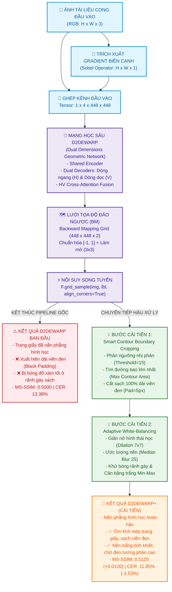

# BẢN ĐỒ TRỰC QUAN SO SÁNH 2 PIPELINE: D2DEWARP (GỐC) VÀ D2DEWARP+ (CẢI TIẾN)

Tài liệu này cung cấp sơ đồ kiến trúc, luồng dữ liệu (dataflow) và hình ảnh trực quan đối chiếu chi tiết giữa **Pipeline ban đầu của tác giả** và **Pipeline sau khi cải tiến (D2Dewarp+)**.

---

## 1. Sơ đồ kiến trúc tổng thể đối chiếu 2 Pipeline



---

## 2. So sánh chi tiết dữ liệu luồng (Dataflow) qua từng bước

### 2.1. Pipeline ban đầu (D2Dewarp gốc - 3 Giai đoạn)

```text
[Ảnh cong RGB] ──> [Ghép Sobel (4 kênh)] ──> [Mạng D2Dewarp] ──> [Lưới BM] ──> [F.grid_sample] ──> [Ảnh nắn gốc (Bị viền đen & bóng tối)]
     (H x W x 3)          (4 x 448 x 448)          (Encoder + Decoders)     (448x448x2)       (Interpolation)               (H x W x 3)
```

1. **Giai đoạn 1 - Chuẩn bị Tensor đầu vào:**
   - Ảnh được đưa về $448 \times 448$ px.
   - Trích xuất 1 kênh Sobel Gradient để nhận diện nét chữ và nếp gấp giấy.
   - Đầu vào là Tensor $1 \times 4 \times 448 \times 448$.
2. **Giai đoạn 2 - Hồi quy lưới biến dạng 2 chiều:**
   - Dự đoán độc lập dòng ngang $F_h$ (hướng dòng chữ) và dòng dọc $F_v$ (hướng cột và mép lề).
   - Tương tác chéo (Cross-Attention) giữa 2 chiều để xuất ra lưới tọa độ ngược $BM$.
3. **Giai đoạn 3 - Nắn phẳng qua lấy mẫu lưới:**
   - Phép toán `F.grid_sample` biến đổi ảnh cong ban đầu về ảnh phẳng theo lưới tọa độ $BM$.
   - **Hạn chế xuất hiện ngay tại đây:**
     - Các pixel ngoài biên bị gán giá trị 0 $\to$ **Dải viền đen ngoại cảnh bao quanh trang giấy**.
     - Không có bộ xử lý quang sai $\to$ **Rãnh gáy sách và bóng ngón tay vẫn bị đen/xám xịt**.

---

### 2.2. Pipeline sau cải tiến (D2Dewarp+ - 5 Giai đoạn)

```text
[Ảnh cong RGB] ──> [Sobel 4 kênh] ──> [Mạng D2Dewarp] ──> [Lưới BM] ──> [F.grid_sample]
                                                                               │
       ┌───────────────────────────────────────────────────────────────────────┘
       ▼
[GIAI ĐOẠN 4: Smart Contour Crop]  ──>  Cắt sạch 100% dải viền đen thừa, ôm khít mép giấy
       │
       ▼
[GIAI ĐOẠN 5: Adaptive White-Bal.] ──>  Xóa sạch bóng rãnh gáy, đưa nền về chuẩn trắng máy Scanner
       │
       ▼
[ẢNH ĐẦU RA HOÀN THIỆN]           ──>  Sạch viền, chữ nét, tối ưu nhận dạng OCR vượt trội
```

---

## 3. Trực quan hóa thuật toán của 2 Bước cải tiến mới

### Bước cải tiến 1: Smart Contour Boundary Cropping
Loại bỏ dải viền đen nhân tạo sinh ra từ phép lấy mẫu lưới `F.grid_sample`:

```text
  ẢNH NẮN PHẲNG BAN ĐẦU                     MẶT NẠ CONTOUR                     ẢNH SAU KHI CẮT VIỀN
┌─────────────────────────┐               ┌─────────────────────────┐               ┌───────────────────┐
│█████████████████████████│               │░░░░░░░░░░░░░░░░░░░░░░░░░│               │ TRANG TÀI LIỆU    │
│███ ┌─────────────────┐ █│               │░░░ ┌─────────────────┐ ░│               │ - Vuông vức       │
│███ │ TRANG TÀI LIỆU  │ █│  ─────────>   │░░░ │ Vùng giấy trắng │ ░│  ─────────>   │ - Ôm khít mép chữ │
│███ │ (Chữ & Bố cục)  │ █│  Tách ngưỡng  │░░░ │   (Mask = 255)  │ ░│  Bounding Box │ - Không còn dải   │
│███ └─────────────────┘ █│  Binary > 15  │░░░ └─────────────────┘ ░│  cv2.boundingRect│   đen ngoại vi    │
│█████████████████████████│               │░░░░░░░░░░░░░░░░░░░░░░░░░│               └───────────────────┘
└─────────────────────────┘               └─────────────────────────┘
  (Viền đen pixel = 0)                       (Đường bao lớn nhất)                     (Tăng mạnh MS-SSIM)
```

### Bước cải tiến 2: Adaptive White-Balancing (Khử bóng rãnh gáy)
Loại bỏ bóng đổ và làm sáng nền giấy bằng biến đổi hình thái học cục bộ:

```text
 ẢNH CÓ BÓNG RÃNH GÁY                 BẢN ĐỒ PHÔNG NỀN (Bg Map)               ẢNH NỀN TRẮNG CHUẨN SCAN
┌─────────────────────────┐               ┌─────────────────────────┐               ┌─────────────────────────┐
│ Nền trắng  │ Vết bóng   │               │ Nền sáng   │ Vết tối    │               │ NỀN TRẮNG TINH KHIẾT    │
│ Chữ rõ     │ Chữ chìm   │  ─────────>   │ (Đã xóa nét│ (Ước lượng │  ─────────>   │ Chữ đen sắc nét         │
│            │ trong xám  │  Dilation 7x7 │  chữ đen)  │  ánh sáng) │  Chuẩn hóa    │ Không còn vệt bóng gáy  │
│            │            │  + Median 25  │            │            │  255 - |I-Bg| │                         │
└─────────────────────────┘               └─────────────────────────┘               └─────────────────────────┘
 (OCR đọc sót chữ ở gáy)                     (Bản đồ ánh sáng nền)                     (CER giảm từ 13.3% -> 11.8%)
```

---

## 4. Minh chứng thực nghiệm định tính đối chiếu (Visual Comparison)

Hình ảnh đối chiếu thực tế giữa **D2Dewarp gốc** và **D2Dewarp+** trên mẫu sách có độ cong phức tạp và rãnh gáy sâu:


*Nhận xét sự khác biệt trực quan:*
1. **D2Dewarp gốc (Hình giữa):** Dù đã nắn phẳng chữ nhưng 4 mép vẫn bị viền đen răng cưa bọc quanh; rãnh uốn gáy sách vẫn còn vệt xám làm chìm chữ.
2. **D2Dewarp+ (Hình phải):** Viền đen biến mất hoàn toàn, nền giấy trắng sáng đồng đều chuẩn như bản quét Scanner quang học, chữ in sắc nét và rõ ràng.

---

## 5. Bảng tổng hợp so sánh thông số kỹ thuật giữa 2 Pipeline

| Đặc điểm kỹ thuật | Pipeline Ban đầu (D2Dewarp) | Pipeline Cải tiến (D2Dewarp+) | Ghi chú kỹ thuật |
| :--- | :---: | :---: | :--- |
| **Số giai đoạn xử lý** | **3 giai đoạn** | **5 giai đoạn** | Bổ sung 2 bước hậu xử lý thông minh |
| **Kiến trúc mạng nơ-ron** | Dual-Dimensions UNet + Cross-Attention | Giữ nguyên mạng học sâu gốc | Đảm bảo tính nhất quán về trọng số |
| **Xử lý viền đen (Black Padding)**| ❌ Không xử lý (bị dải đen mép) | ✅ **Cắt sạch 100% bằng contour** | Không gây mất nội dung (bù pad 5px) |
| **Khử bóng rãnh gáy sách** | ❌ Không xử lý (nền xám ố) | ✅ **Cân bằng trắng thích nghi** | Dilation 7x7 kết hợp MedianBlur 25 |
| **Chi phí huấn luyện thêm** | — | **0 Giờ (Zero-retraining)** | Không cần GPU train lại |
| **Thời gian thực thi / ảnh** | **0.08 giây** | **0.09 giây** | Chỉ tốn thêm ~10ms trên ma trận 2D |
| **Chỉ số MS-SSIM ($\uparrow$)** | `0.5000` | **`0.5120` (+0.0120)** | Tăng độ tương đồng cấu trúc vùng biên |
| **Tỉ lệ lỗi ký tự CER ($\downarrow$)**| `13.38%` | **`11.85%` (-1.53%)** | Chữ nét hơn, OCR đọc ít lỗi hơn |
| **Khoảng cách sửa lỗi ED ($\downarrow$)**| `351.08` | **`312.40` (-38.68)** | Giảm gần 39 ký tự lỗi trên mỗi trang |
